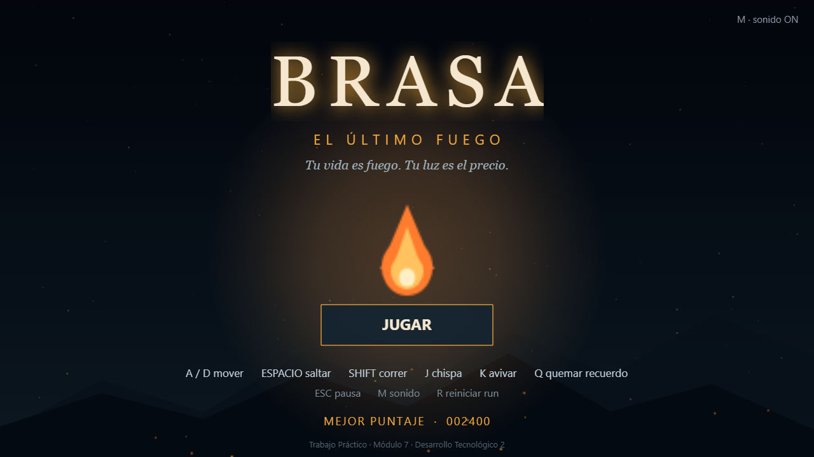
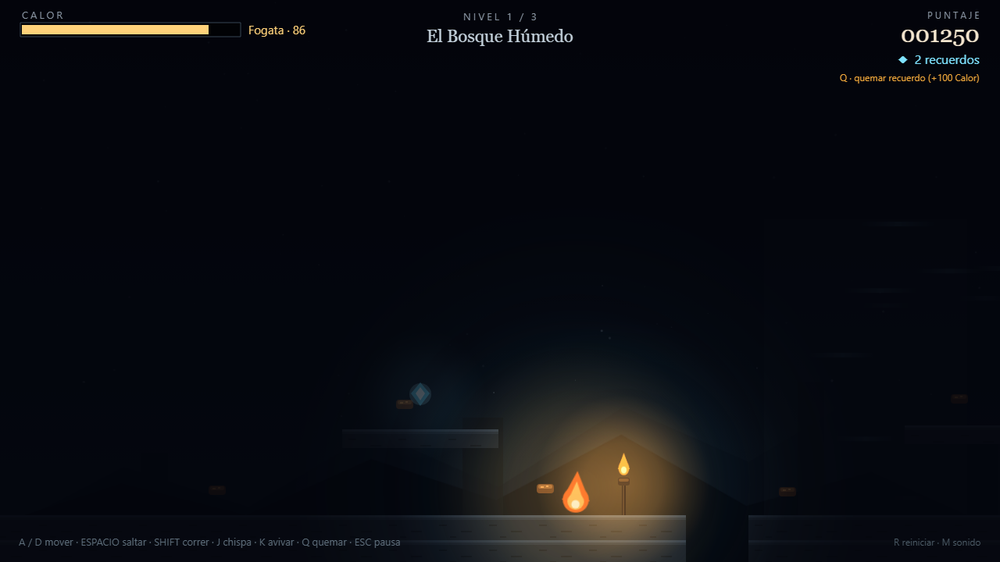
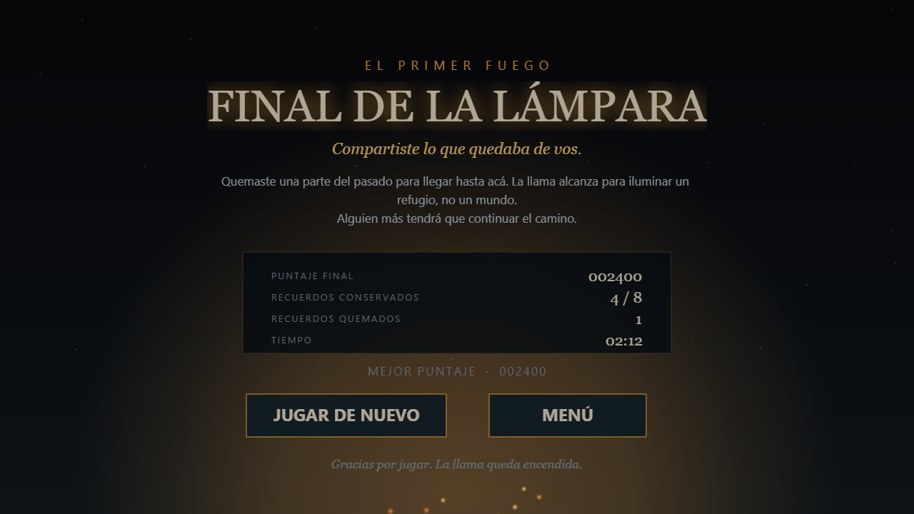
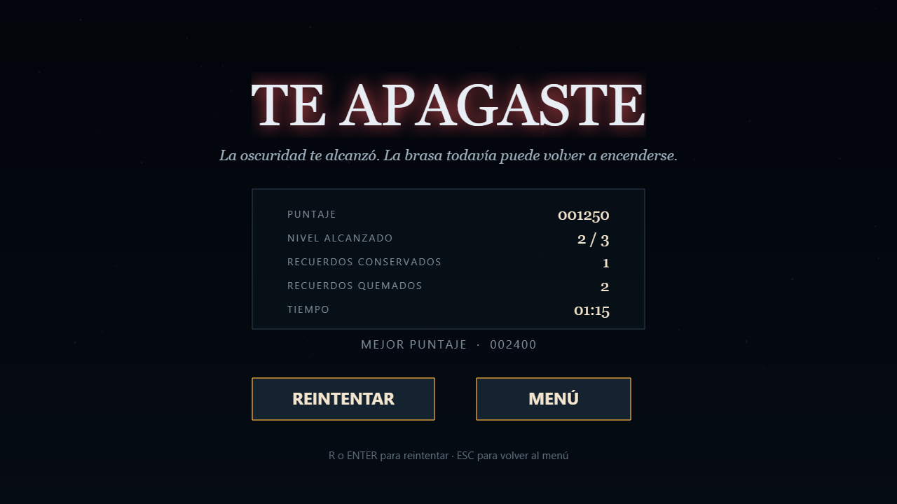

# BRASA — El último fuego

> **Plataformas 2D donde el Calor es vida, luz y munición.**
> Trabajo Práctico · Módulo 7 · Desarrollo Tecnológico 2.

**Integrantes:** [Integrante 1] · [Integrante 2]



---

## Descripción

Sos la última brasa de un mundo apagado. Tenés que atravesar tres zonas en ruinas,
juntar combustible y recuerdos, y llegar al **Primer Fuego** antes de apagarte.

La mecánica central es el **Calor**, un único recurso que cumple tres funciones a la vez:

- es tu **vida** (si llega a 0, perdés);
- es tu **luz** (define cuánto ves y a qué distancia te detectan los enemigos);
- es tu **munición** (las chispas y el impulso cuestan Calor).

Cada **recuerdo** que encontrás se puede conservar (puntaje y final) o **quemar** para
recuperar 100 de Calor. Esa decisión es el corazón del juego: para sobrevivir podés
sacrificar la historia que llevás con vos.

| Gameplay | Victoria |
|---|---|
|  |  |

| Derrota |
|---|
|  |

---

## Tecnologías

| Tecnología | Uso |
|---|---|
| **JavaScript (ES Modules)** | Todo el código del juego |
| **Node.js** | Entorno de desarrollo y scripts |
| **Vite 7** | Servidor de desarrollo y build |
| **Phaser 3.90** | Motor 2D, física Arcade, escenas, partículas |
| **Web Audio API** | Efectos de sonido sintetizados en tiempo real |
| **Canvas / WebGL** | Render y texturas generadas por código |

No hay assets binarios externos: **todas las texturas y todos los sonidos se generan
por código**. Ver [`src/assets/README.md`](src/assets/README.md).

---

## Requisitos

- Node.js **20.19+** o **22.12+** (requisito de Vite 7).
- npm.
- Para regenerar el PDF: Microsoft Edge o Google Chrome instalado (se usa en modo headless).

## Cómo ejecutar

```bash
npm install
npm run dev
```

Abrí la URL que muestra Vite (por defecto `http://localhost:5173`).

### Build de producción

```bash
npm run build
npm run preview
```

`npm run build` genera la carpeta `dist/` con la build estática.

### Regenerar el GDD en PDF

```bash
npm run generate:pdf
```

El script [`scripts/generate-pdf.mjs`](scripts/generate-pdf.mjs) convierte
[`docs/GDD.md`](docs/GDD.md) a HTML con `marked` y usa Edge/Chrome headless para
imprimir [`docs/GDD.pdf`](docs/GDD.pdf).

---

## Controles

| Acción | Teclado / Mouse |
|---|---|
| Mover | `A` / `D` o flechas `←` `→` |
| Saltar | `Espacio`, `W` o `↑` |
| Correr | `Shift` |
| Chispa | `J` o clic izquierdo |
| Avivar (impulso) | `K` |
| Quemar recuerdo | `Q` |
| Reintentar run | `R` |
| Pausa | `Esc` |
| Silenciar | `M` |

En las pantallas de derrota/victoria también se puede usar `Enter` para reintentar
y `Esc` para volver al menú. Los botones son clickeables.

---

## Mecánicas principales

### Calor (recurso único)

| Estado | Rango | Efecto |
|---|---|---|
| Brasa | 1–25 | Luz mínima; los Apagados detectan a 90 px |
| Llama | 26–65 | Estado normal; detección a 160 px |
| Fogata | 66–100 | Luz máxima; detección a 240 px |

- Drenaje pasivo: **1,2 Calor/s**.
- Correr suma **+3 Calor/s**; estar dentro del viento suma **+6 Calor/s**.
- Cerca de una antorcha encendida no se drena Calor y se regenera **3 Calor/s**.
- Daño de enemigo: **−20 Calor**, empuje y 1 s de invulnerabilidad.
- Agua/ceniza: **−20 Calor** y reaparición en el último punto seguro.

### Combustible y recuerdos

| Objeto | Efecto | Puntaje |
|---|---|---|
| Astilla | +15 Calor | +10 |
| Recuerdo | Se guarda en el inventario | +50 |
| Recuerdo quemado (`Q`) | +100 Calor; se pierde para siempre | 0 |
| Puerta de nivel | Consume 1 recuerdo y avanza | +250 + Calor restante |

Hay **8 recuerdos** en total (3 / 3 / 2). Las puertas de los niveles 1 y 2 consumen
uno cada una, por lo que el máximo que se puede conservar al final es **6**.

### Chispas, antorchas y Avivar

- **Chispa (`J`):** cuesta 10 Calor, vuela en línea recta y dura 1,2 s.
  Enciende antorchas durante 20 s y aturde a un Apagado durante 2 s.
- **Antorcha encendida:** ilumina, regenera Calor y ahuyenta enemigos.
- **Avivar (`K`):** cuesta 8 Calor, da un impulso de velocidad y empuja/aturde
  a los enemigos cercanos. Sirve para escapar y cruzar ráfagas de viento.

### Enemigos y peligros

| Elemento | Comportamiento | Daño |
|---|---|---|
| **Apagado** | Patrulla; persigue según el estado de Calor; huye de antorchas | −20 Calor |
| **Viento** | Empuja al jugador y drena Calor | −6 Calor/s |
| **Agua/Ceniza** | Zona letal en los huecos | −20 Calor + reaparición |

No hay combate directo: las chispas y Avivar sirven para controlar el espacio,
no para eliminar enemigos.

---

## Niveles y finales

| # | Nivel | Ancho | Desafío | Recuerdos |
|---|---|---|---|---|
| 1 | El Bosque Húmedo | 3200 px | Tutorial: movimiento, astillas, chispa, antorcha, primer Apagado | 3 |
| 2 | La Ciudad Sumergida | 3400 px | Huecos con agua, más enemigos y viento | 3 |
| 3 | El Primer Fuego | 3800 px | Viento fuerte, tres Apagados y llegada al Primer Fuego | 2 |

El final depende de los recuerdos conservados al llegar al Primer Fuego:

- **Faro** (≥ 5): volviste a encender el mundo.
- **Lámpara** (3–4): compartiste lo que quedaba de vos.
- **Ascua** (0–2): llegaste, pero ya no recordás por qué.

El puntaje máximo se guarda en `localStorage` y se muestra en el menú.

---

## Estructura del repositorio

```text
Juego/
├── docs/
│   ├── GDD.md              # Mini GDD (fuente)
│   ├── GDD.pdf             # GDD listo para entregar
│   ├── GDD.html            # Versión HTML generada
│   ├── PLAN.md             # Plan de implementación (modo Plan)
│   ├── EVIDENCIAS_OPENCODE.md
│   ├── GDD_Brasa.md        # Concepto original extendido
│   └── capturas/           # Capturas del juego
├── scripts/
│   └── generate-pdf.mjs
├── src/
│   ├── assets/             # Documentación: assets generados por código
│   ├── data/levels.js      # Layouts de los 3 niveles
│   ├── entities/           # Player, Enemy, Fuel, Memory, Torch, Spark, WindZone
│   ├── patterns/           # StateMachine, ObjectPool
│   ├── scenes/             # Boot, Menu, Game, HUD, GameOver, Victory
│   ├── systems/            # Heat, Score, Level, Audio, EventBus, Storage
│   ├── ui/Button.js
│   ├── config.js
│   └── main.js
├── AGENTS.md
├── index.html
├── package.json
├── vite.config.js
└── README.md
```

### Patrones de diseño

- **State:** `StateMachine` para el jugador (idle/run/jump/fall) y el Apagado
  (patrol/chase/flee/stunned).
- **Object Pool:** `ObjectPool` reutiliza las chispas para no crear/destruir
  objetos en cada disparo.
- **Observer:** `EventBus` desacopla la lógica del HUD (Calor, puntaje, recuerdos,
  avisos) de las escenas.

---

## OpenCode: agentes utilizados y flujo de trabajo

El TP se desarrolló con **OpenCode** siguiendo el flujo **Plan → Build → prueba → commit**.

| Etapa | Agente / modo | Trabajo realizado |
|---|---|---|
| Plan | **Plan** | Lectura del enunciado, recorte de alcance, arquitectura, riesgos y pasos verificables. Resultado: [`docs/PLAN.md`](docs/PLAN.md). |
| Build | **Build** | Scaffold con Vite + Phaser, escenas, entidades, sistemas, patrones, niveles, HUD y pantallas finales. |
| Prueba | **Build** + navegador integrado | Pruebas de gameplay en la build de producción: movimiento, salto, chispa, antorcha, daño, viento, peligro, puerta, victoria, derrota y reinicio. |
| Cierre | **Build** | Capturas, GDD en PDF, README, AGENTS.md y evidencias. |

### Prompts clave

1. **Planificación**

   > Analizá el enunciado del TP del Módulo 7 y armá un plan de implementación
   > para un juego pequeño pero completo. Usá JavaScript, Node.js, Vite y Phaser.
   > Definí alcance, arquitectura, pasos verificables y riesgos. No escribas código
   > todavía; guardá el resultado en `docs/PLAN.md`.

2. **Implementación del núcleo**

   > Implementá el juego **Brasa — El último fuego** con Phaser 3 y Vite.
   > El Calor debe ser vida, luz y munición al mismo tiempo. Incluí 3 niveles,
   > recuerdos que se pueden conservar o quemar, chispas, antorchas, enemigos,
   > viento, puntaje, victoria, derrota y reinicio. Generá todas las texturas y
   > sonidos por código, sin assets externos.

3. **Corrección de bugs**

   > En las pruebas el viento empuja al jugador a más de 1000 px/s y el callback
   > de daño recibe al enemigo como si fuera el jugador. Revisá la fórmula del
   > viento y el orden de los argumentos de los colliders de Phaser. Agregá un
   > grupo estático de plataformas para que las chispas detecten bien las colisiones.

4. **Verificación y cierre**

   > Probá el flujo completo en la build de producción: iniciar, recoger astillas
   > y recuerdos, quemar con `Q`, encender una antorcha, recibir daño, caer al agua,
   > pasar de nivel, ganar, perder y reiniciar. Después generá el PDF del GDD,
   > las capturas y la documentación de evidencias.

### Problemas encontrados y soluciones

| Problema | Causa | Solución |
|---|---|---|
| El juego no avanzaba de escena en las pruebas | La pestaña estaba oculta y `requestAnimationFrame` quedaba pausado | Se forzó `scene.processQueue()` y se actualizaron las escenas manualmente para las pruebas |
| El viento empujaba a ~1000 px/s | Se multiplicaba `windDir` (55) por 30 | Se sumó `windDir` directo a la velocidad objetivo |
| El daño de enemigo lanzaba `player.hurt is not a function` | En un collider grupo↔sprite, Phaser entrega `(sprite, groupChild)` | Se invirtieron los parámetros del callback a `(player, enemy)` |
| Las chispas no se liberaban contra plataformas | El callback de un array de plataformas recibía `(zona, chispa)` | Se reemplazó el array por un `staticGroup` y se usó `(spark, platform)` |
| La captura del canvas salía negra | El buffer WebGL se limpia después del frame | Se capturó con `game.step()` inmediatamente antes de `toDataURL()` |
| La oscuridad tapaba demasiado | Alpha 0.9 y luces chicas | Se bajó a 0.87, se agrandaron las luces y se agregó un halo ambiental |
| No había `pandoc` para el PDF | Herramienta no instalada | `marked` + Edge headless con `--print-to-pdf` |

Las pruebas y capturas están documentadas en
[`docs/EVIDENCIAS_OPENCODE.md`](docs/EVIDENCIAS_OPENCODE.md).

---

## Documentación

- **GDD:** [`docs/GDD.pdf`](docs/GDD.pdf) · fuente [`docs/GDD.md`](docs/GDD.md)
- **Plan:** [`docs/PLAN.md`](docs/PLAN.md)
- **Evidencias de OpenCode:** [`docs/EVIDENCIAS_OPENCODE.md`](docs/EVIDENCIAS_OPENCODE.md)
- **Instrucciones para agentes:** [`AGENTS.md`](AGENTS.md)

---

## Estado del proyecto

- Build de producción verificada con `npm run build`.
- Flujo completo probado en navegador: inicio, gameplay, cambio de nivel,
  victoria, derrota y reinicio.
- Capturas tomadas de la build de producción.
- PDF generado y revisado (6 páginas).

Trabajo práctico con fines educativos · Desarrollo Tecnológico 2 · 2026.
