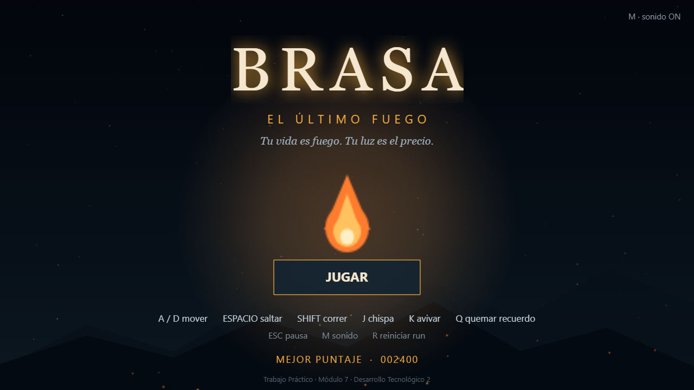
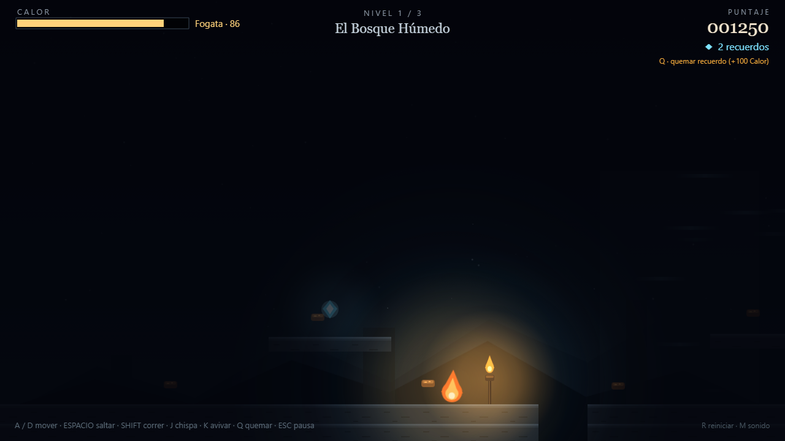
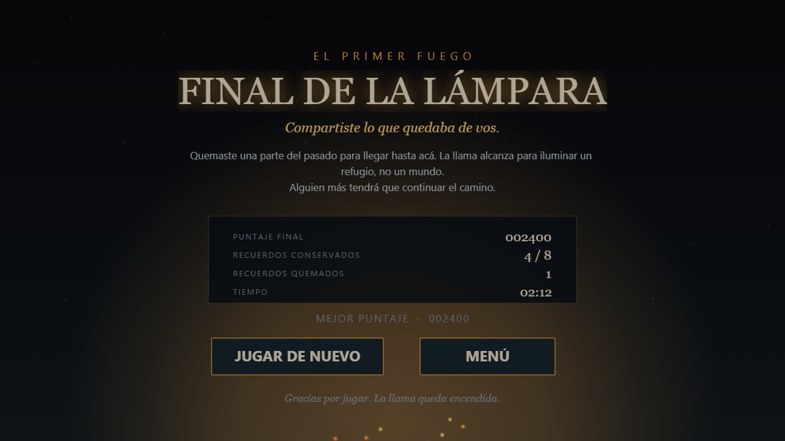
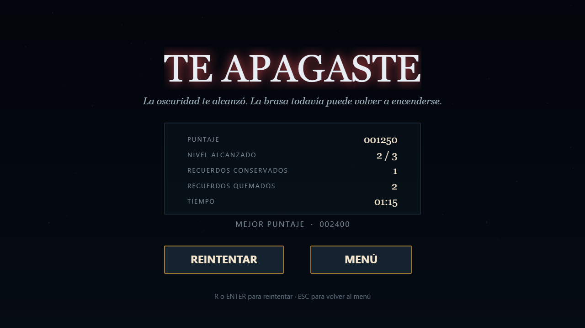

# Evidencias de uso de OpenCode — Brasa

**Trabajo Práctico · Módulo 7 · Desarrollo Tecnológico 2**
**Proyecto:** Brasa — El último fuego
**Integrante:** Santiago Tornau
**Repositorio:** <https://github.com/acloshh/Actividad-Modulo-7-Desarrollo-Tecnologico>
**Fecha:** Noviembre de 2026

Este documento registra cómo se usó **OpenCode** para planificar, construir, probar
y documentar el juego, incluyendo prompts, iteraciones, errores y verificaciones.

---

## 1. Herramientas y flujo de trabajo

| Etapa | Herramienta / agente | Resultado |
|---|---|---|
| Plan | OpenCode en modo **Plan** | [`docs/PLAN.md`](PLAN.md) con alcance, arquitectura, 8 pasos y riesgos |
| Build | OpenCode agente **Build** | Código completo en `src/` |
| Prueba | OpenCode + navegador integrado | Build de producción verificada y capturas |
| Cierre | OpenCode agente **Build** | GDD en PDF, README, AGENTS.md y este documento |

Flujo aplicado: **Plan → Build → probar → corregir → commit**. La última
iteración siguió además el flujo definido en `AGENTS.md`: revisar documentación →
crear rama → implementar → verificar → pedir confirmación → commit y push.

La pestaña del navegador de pruebas se controló desde OpenCode con el hook
`window.__BRASA__` y ejecución de scripts en la página. No se usaron herramientas
externas de automatización.

---

## 2. Etapa Plan

### Prompt principal

> Analizá el enunciado del TP del Módulo 7 y armá un plan de implementación para un
> juego pequeño pero completo. Usá JavaScript, Node.js, Vite y Phaser. Definí alcance,
> arquitectura, pasos verificables y riesgos. No escribas código todavía; guardá el
> resultado en `docs/PLAN.md`.

### Decisiones tomadas en Plan

- Adaptar el concepto original de **Brasa** a un plataformas 2D de **3 niveles**
  (10–15 minutos), en lugar de un RPG o un juego más grande.
- Convertir el **Calor** en el recurso central: vida + luz + munición.
- Usar **recuerdos** como decisión de riesgo: conservar (puntaje/final) o quemar
  (+100 Calor).
- Generar **todas las texturas y sonidos por código** para no depender de assets
  externos y facilitar la entrega.
- Aplicar tres patrones: **State**, **Object Pool** y **Observer**.
- Separar el HUD en una escena paralela para no acoplar la interfaz a `GameScene`.

El plan completo quedó en [`docs/PLAN.md`](PLAN.md).

---

## 3. Etapa Build

### Secuencia de implementación

| Iteración | Trabajo | Archivos principales |
|---|---|---|
| 1 | Scaffold de Vite + Phaser | `package.json`, `vite.config.js`, `index.html`, `src/main.js` |
| 2 | Texturas por código y menú | `src/scenes/BootScene.js`, `src/scenes/MenuScene.js`, `src/ui/Button.js` |
| 3 | Jugador, Calor, cámara y oscuridad | `src/entities/Player.js`, `src/systems/HeatSystem.js`, `src/scenes/GameScene.js` |
| 4 | Niveles como datos | `src/data/levels.js`, `src/systems/LevelManager.js` |
| 5 | Recuerdos, chispas, antorchas y pool | `Memory.js`, `Spark.js`, `Torch.js`, `patterns/ObjectPool.js` |
| 6 | Enemigos, viento y peligros | `Enemy.js`, `WindZone.js`, `patterns/StateMachine.js` |
| 7 | HUD, puntaje y progresión | `HUDScene.js`, `ScoreSystem.js`, `EventBus.js`, `Storage.js` |
| 8 | Finales, derrota y reinicio | `GameOverScene.js`, `VictoryScene.js` |
| 9 | Audio sintetizado y pulido | `AudioSystem.js`, partículas, pausa |
| 10 | PDF, capturas y documentación | `scripts/generate-pdf.mjs`, `README.md`, `AGENTS.md` |
| 11 | Ajuste de `AGENTS.md` al modelo de la cátedra | `AGENTS.md` (referencia: `docs/agents.pdf`) |

### Prompts clave usados en Build

1. **Núcleo del juego**

   > Implementá Brasa con Phaser 3 y Vite. El Calor debe ser vida, luz y munición.
   > Incluí 3 niveles, recuerdos que se conservan o se queman, chispas, antorchas,
   > enemigos, viento, puntaje, victoria, derrota y reinicio. Todo el arte y el audio
   > debe generarse por código.

2. **Niveles data-driven**

   > Armá los 3 niveles en `src/data/levels.js` y un `LevelManager` que construya
   > plataformas, astillas, recuerdos, antorchas, enemigos, viento, peligros y salida.
   > Cada nivel debe poder completarse con el salto actual y tener al menos un recuerdo
   > alcanzable antes de la puerta.

3. **Patrones**

   > Aplicá State para el jugador y el enemigo, Object Pool para las chispas y Observer
   > con un EventBus para desacoplar el HUD de la lógica del juego.

4. **Corrección de bugs**

   > En las pruebas el viento empuja a más de 1000 px/s y el callback de daño recibe al
   > enemigo como si fuera el jugador. Revisá la fórmula del viento y el orden de los
   > argumentos de los colliders. Usá un `staticGroup` para las plataformas.

5. **Verificación y cierre**

   > Probá el flujo completo en la build de producción: iniciar, recoger astillas y
   > recuerdos, quemar con Q, encender una antorcha, recibir daño, caer al agua, pasar
   > de nivel, ganar, perder y reiniciar. Después generá el PDF, las capturas y las
   > evidencias.

6. **Ajuste del AGENTS.md**

   > El `AGENTS.md` tenía que seguir el modelo de `docs/agents.pdf`, el que pasaron
   > en la cátedra. Revisá ese PDF y adaptá el archivo al proyecto.

   Se consultaron dos decisiones antes de avanzar: adoptar una rama por tarea y
   limitar el archivo al modelo del PDF, sin anexos técnicos. La implementación se
   hizo en `docs/agents-md-modelo` (`48d0aec`) y se integró en `main` (`740a8e1`).

---

## 4. Pruebas realizadas

### 4.1 Build y servidores

| Comando | Resultado |
|---|---|
| `npm install` | Dependencias instaladas (Phaser 3.90, Vite 7.3.8, marked) |
| `npm run build` | 32 módulos; `dist/assets/index-*.js` ≈ 1.263 MB (348 KB gzip) |
| `npm run preview -- --port 4173` | HTTP 200; juego cargado con Phaser 3.90 / WebGL |
| `npm run dev -- --port 5173` | HTTP 200; servidor de desarrollo operativo |
| `npm run generate:pdf` | `docs/GDD.pdf` de 228 KB, 6 páginas |

### 4.2 Pruebas funcionales en navegador

Se ejecutaron desde la consola del navegador sobre la build de producción.
Los valores son los observados en las pruebas.

| # | Caso | Resultado |
|---|---|---|
| 1 | Inicio desde el menú con `Enter` | `GameScene` + `HUDScene` activas; nivel 0; Calor 99,3 |
| 2 | Recoger astilla | Calor 50 → 64,6; puntaje +10; quedan 14 astillas |
| 3 | Recoger recuerdo | Recuerdos 1; puntaje +50 |
| 4 | Quemar recuerdo con `Q` | Calor 40 → 100; recuerdos 0; quemados 1 |
| 5 | Daño de enemigo | Calor 80 → 59,8; invulnerabilidad activa; empuje aplicado |
| 6 | Viento | Calor 80 → 72,8 en 1 s; desplazamiento ≈ 51 px |
| 7 | Caer al agua | Reaparición en el último punto seguro; Calor 80 → 59,9 |
| 8 | Puerta de nivel | Nivel 0 → 1; puntaje 519; recuerdo consumido |
| 9 | Victoria | Puntaje 2400; 4 recuerdos → **Final de la Lámpara** |
| 10 | Derrota | `GameOverScene` activa; mejor puntaje guardado: 2400 |
| 11 | Reinicio con `R` | Nivel 0; puntaje 0; Calor 100; recuerdos 0; quemados 0 |
| 12 | Pausa con `Esc` | Activa y desactiva correctamente |
| 13 | Movimiento y salto | `D` desplaza 88 px; salto con `Espacio` → velocidad −563 |
| 14 | Chispa con `J` | 1 chispa activa; Calor 100 → 90 |
| 15 | Chispa contra plataforma | 1 disparada → 0 activas tras la colisión |
| 16 | Antorcha | Se enciende con la chispa y queda `isLit = true` |
| 17 | Mejor puntaje | Persistido en `localStorage` (`brasa:best-score`) |
| 18 | Autopiloto nivel 1 | 935 frames; x máx. 3033; transición 0 → 1 |
| 19 | Autopiloto nivel 2 | 1017 frames; x máx. 3244; transición 1 → 2 |
| 20 | Autopiloto nivel 3 | 1108 frames; x máx. 3643; `VictoryScene` activa |
| 21 | Clic en JUGAR y volver al menú | El botón inicia la partida; al volver al menú, `transitioning` se reinicia y JUGAR vuelve a funcionar |

Las pruebas 18–20 usaron un autopiloto que corre y salta, con el Calor fijo en 100
y el jugador invulnerable, para aislar la **transitabilidad física** de los niveles
(plataformas, huecos y puertas). No evalúan el balance de recursos, que se probó
por separado en las pruebas 2–8.

### 4.3 Capturas de la build de producción

| Menú | Gameplay |
|---|---|
|  |  |

| Victoria (Lámpara) | Derrota |
|---|---|
|  |  |

---

## 5. Errores encontrados y soluciones

| # | Error | Diagnóstico | Solución |
|---|---|---|---|
| 1 | El juego no pasaba de escena en las pruebas | La pestaña estaba oculta y `requestAnimationFrame` se pausaba | Se llamó a `scene.processQueue()` y se actualizaron las escenas manualmente |
| 2 | Viento a ~1000 px/s | `windDir` (55) se multiplicaba por 30 | Se sumó `windDir` directo a la velocidad objetivo |
| 3 | `player.hurt is not a function` al tocar un enemigo | Phaser entrega `(sprite, groupChild)` en colisiones grupo↔sprite | Callback cambiado a `(player, enemy)` |
| 4 | Las chispas no desaparecían al chocar con plataformas | El callback de un array recibía `(zona, chispa)` | Se usó un `staticGroup` y callback `(spark, platform)` |
| 5 | Capturas del canvas completamente negras | El buffer WebGL se limpia después del frame | `game.step()` inmediatamente antes de `toDataURL()` |
| 6 | La oscuridad tapaba casi todo | Alpha 0.9 y luces pequeñas | Alpha 0.87, luces más grandes y halo ambiental |
| 7 | Enemigos podían salir de su segmento al perseguir | Clamp a `minX - 90` / `maxX + 90` | Clamp a `minX` / `maxX` |
| 8 | No había `pandoc` para el PDF | Herramienta ausente | `marked` + Edge headless (`--print-to-pdf`) |
| 9 | Al volver al menú, JUGAR no respondía | `MenuScene.transitioning` quedaba en `true` al reutilizar la escena | Se reinicia `transitioning` al comienzo de `create()` |

Cada corrección se verificó con una nueva build de producción y una prueba en el
navegador. La build final termina sin errores de consola.

---

## 6. Historial de commits

| Commit | Mensaje | Contenido |
|---|---|---|
| `78741fc` | `chore: scaffold Vite + Phaser project` | `package.json`, lockfile, Vite, `index.html`, configuración y punto de entrada |
| `af24453` | `feat: implement game scenes, entities, systems and levels` | Escenas, entidades, sistemas, patrones y los 3 niveles |
| `d071347` | `docs: add GDD, plan, README and agent guide` | GDD, PLAN, README, AGENTS y script de PDF |
| `f2beec7` | `docs: add production screenshots and OpenCode evidence` | Capturas, PDF final y este documento |
| `64d2257` | `test: verify full-level traversal with autopilot` | Pruebas 18–20 de transitabilidad |
| `b7e8692` | `fix: reset menu transition state when returning to menu` | Reinicio de `MenuScene.transitioning` y prueba 21 |
| `0d4f612` | `docs: use singular author label` | Etiqueta de autoría en singular en `README.md` |
| `48d0aec` | `docs: rewrite AGENTS.md following the course template` | `AGENTS.md` con las 11 secciones del modelo |
| `740a8e1` | `docs: merge AGENTS.md template update` | Integración del cambio anterior en `main` |

> El historial completo se puede ver con `git log --oneline --decorate`.

---

## 7. Entrega

- [x] Integrante: **Santiago Tornau**.
- [x] Repositorio: <https://github.com/acloshh/Actividad-Modulo-7-Desarrollo-Tecnologico>.
- [ ] Enviar por Campus Virtual: nombre del juego, integrante, URL del repo,
  link al `docs/GDD.pdf` y descripción del trabajo con OpenCode.

---

## 8. Conclusión

OpenCode se usó como asistente de desarrollo en las etapas de planificación,
implementación, depuración y documentación. El resultado es un juego jugable de
principio a fin, con una build reproducible, pruebas registradas y documentación
suficiente para que otra persona pueda ejecutarlo, entenderlo y continuarlo.
